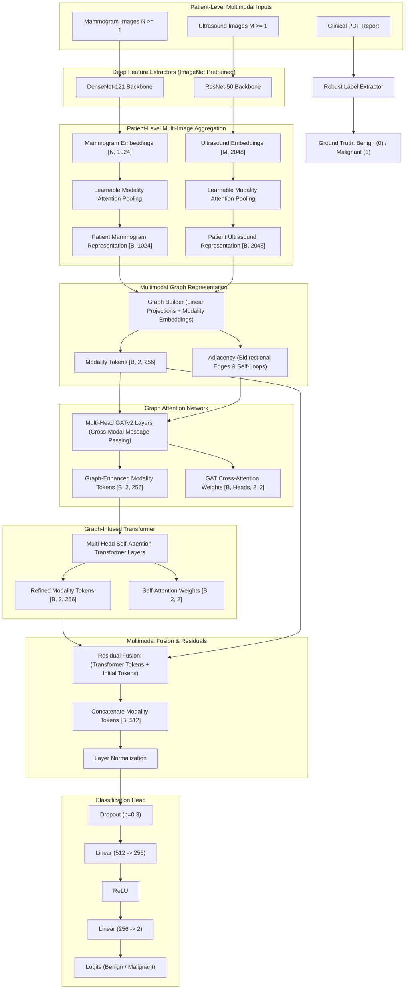

# Multimodal Breast Cancer Classification Framework (BCMID)

A research-grade multimodal deep learning framework for breast cancer classification (Benign vs. Malignant) utilizing the Breast Cancer Multimodal Imaging Dataset (BCMID), combining Full-Field Digital Mammography (FFDM), Ultrasound (US) imaging, and clinical diagnostic reports.

---

## 1. Architectural Overview



---

## 2. Dataset Structure & Clinical Label Extraction

### Dataset Inspection
The BCMID repository contains patient-wise subdirectories:
```
BCMID/
├── 00074y23/
│   ├── Mammogram/
│   │   ├── 00074y23_R_CC_1.png
│   │   └── 00074y23_R_MLO_1.png
│   ├── Ultrasound/
│   │   ├── 00074y23_US_R_1.png
│   │   └── ...
│   └── (optional) report.pdf
└── ...
```
- **332 Patients**: 100% have both Mammogram and Ultrasound folders.
- **951 Mammograms**: High-resolution grayscale images (`L` mode), 1–4 views per patient (CC and MLO projections).
- **1,050 Ultrasounds**: Color/RGB images (`RGBA` mode), 1–16 frames per patient.
- **321 Clinical Reports**: Structured PDF radiology reports.

### Ground-Truth Extraction
The clinical reports contain radiology impressions and BI-RADS assessments. The `src/data/label_extractor.py` module extracts labels without relying on filenames:
- **Filtering**: Strips out standardized reference footers containing dictionary definitions.
- **Spelling-Robust BI-RADS Parsing**: Captures `BIRADS`, `BI-RADS`, `BIARADS`, `BIRDAS`, and `BIRAD` (categories 0–6).
- **Label Mapping**:
  - `BENIGN` (Class 0): BI-RADS 1, 2, 3, clear post-surgical follow-ups, fibroadenomas, simple cysts.
  - `MALIGNANT` (Class 1): BI-RADS 4 (4a, 4b, 4c), 5, 6, pathologically proven carcinomas, neoadjuvant localization clips/markers.
  - `UNKNOWN` (Class -1): Missing reports (11 patients), unreadable scans (1 patient), or non-diagnostic impressions (3 patients). **Strictly excluded from supervised training to prevent label noise.**

---

## 3. Patient-Level Splitting & Anti-Leakage Protocol

> [!IMPORTANT]
> Image-level splitting in medical imaging causes severe data leakage. In this project, splitting is performed strictly at the **PATIENT** level. All mammograms and ultrasounds for any given patient reside in exactly one split (Train, Validation, or Test).

- **Stratified Split**: 70% Train, 15% Validation, 15% Test.
- **Class Imbalance Management**: The cohort has ~80% Benign and ~16% Malignant patients. The training pipeline applies class-weighted cross-entropy loss:
  $$w_c = \frac{N}{2 \cdot N_c}$$

---

## 4. Primary Model & Baseline Comparison

This framework implements and benchmarks 4 architectures:
1. **Mammogram-Only DenseNet-121**: ImageNet-pretrained backbone with attention-pooling over mammogram views.
2. **Ultrasound-Only ResNet-50**: ImageNet-pretrained backbone with attention-pooling over ultrasound frames.
3. **Simple Concatenation Fusion**: Early/late concatenation baseline combining pooled mammogram and ultrasound vectors into an MLP.
4. **Proposed Multimodal Graph-Infused Transformer**:
   - Projection to a shared 256-dimensional space with learnable modality embeddings.
   - Multi-Head GATv2 layer propagating cross-modal signals.
   - Graph-Infused Transformer encoder applying Multi-Head Self-Attention across graph tokens.
   - Residual connection and balanced classification head.

---

## 5. Memory-Efficient GPU Optimization

Designed to run smoothly on workstation and budget laptop GPUs (e.g., NVIDIA GeForce MX550 with 2GB VRAM):
- **Automatic Mixed Precision (AMP)**: `torch.amp.autocast('cuda')` and `GradScaler`.
- **Gradient Accumulation**: Simulated batch size via configurable accumulation steps.
- **Two-Stage Fine-Tuning**: Convolutional backbones are frozen initially; heads, graph, and transformer layers train first before gradual unfreezing.
- **Automatic Device Selection**: Auto-detects CUDA GPU with seamless CPU fallback.

---

## 6. Installation & Execution

### Setup
```bash
pip install -r requirements.txt
```

### 1. Inspect Dataset
```bash
python scripts/inspect_dataset.py
```

### 2. Prepare Dataset Manifest & Splits
```bash
python scripts/prepare_dataset.py
```

### 3. Verify All Components (Architecture Unit Tests)
```bash
python scripts/verify_components.py
```

### 4. Train Models
```bash
# Standalone Mammogram model
python scripts/train_densenet.py

# Standalone Ultrasound model
python scripts/train_resnet.py

# Simple Fusion baseline
python scripts/train_fusion.py

# Proposed Multimodal Graph-Infused Transformer
python scripts/train_graph_transformer.py
```

### 5. Evaluate & Generate Comparison Report
```bash
python scripts/evaluate.py
```

### 6. Unified CLI
```bash
python main.py --action smoke_test
python main.py --action train --model graph_transformer
python main.py --action eval
```

---

## 7. Explainability & Clinical Disclaimer

- **Grad-CAM**: Generates class activation maps for DenseNet-121 and ResNet-50 layers (`src/explainability/gradcam.py`).
- **Attention Visualization**: Visualizes GATv2 cross-attention and Transformer self-attention matrices.

> [!CAUTION]
> **Research Disclaimer**: This software is an experimental artificial intelligence research prototype developed for academic and scientific inquiry. It has not been approved by any regulatory health agency (e.g., FDA, CE-IVD) and must NOT be used as a clinical diagnostic decision-support tool.
