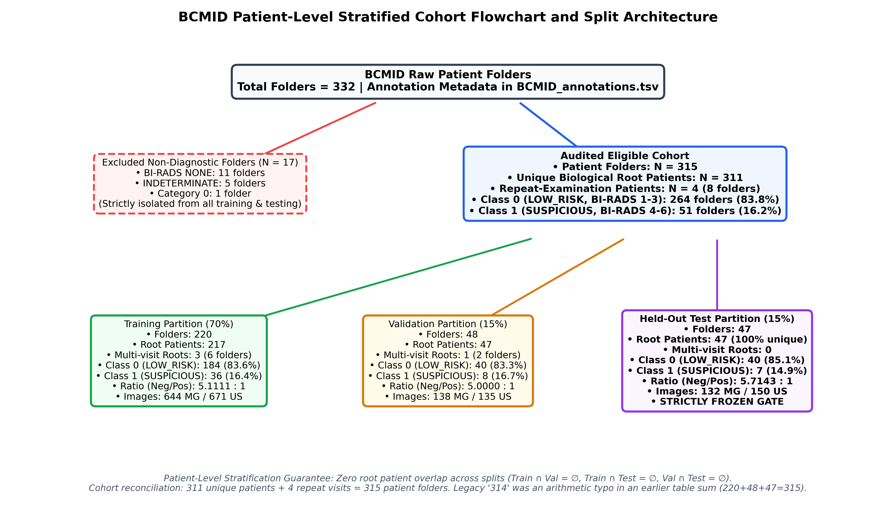
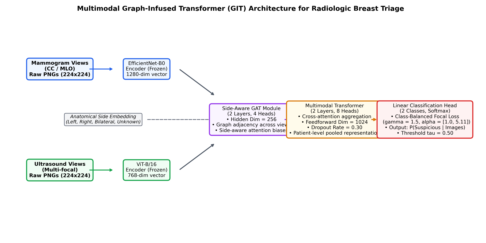
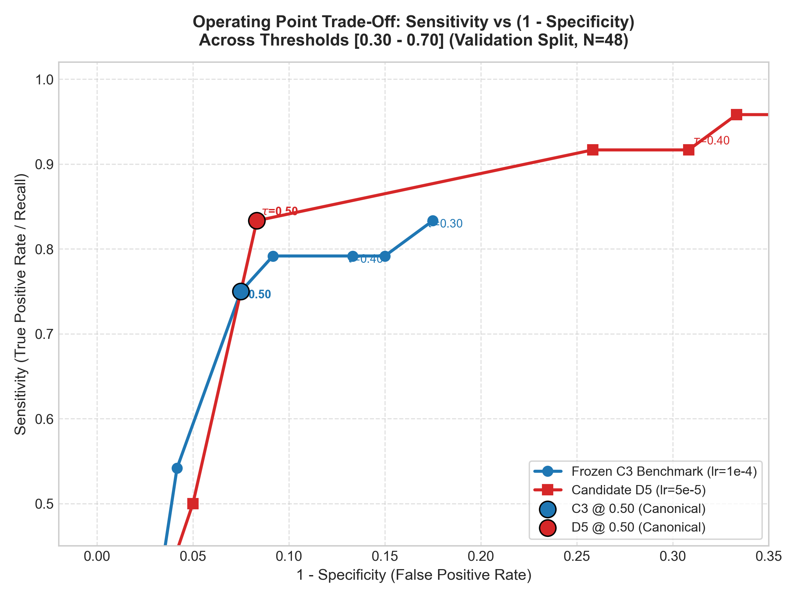
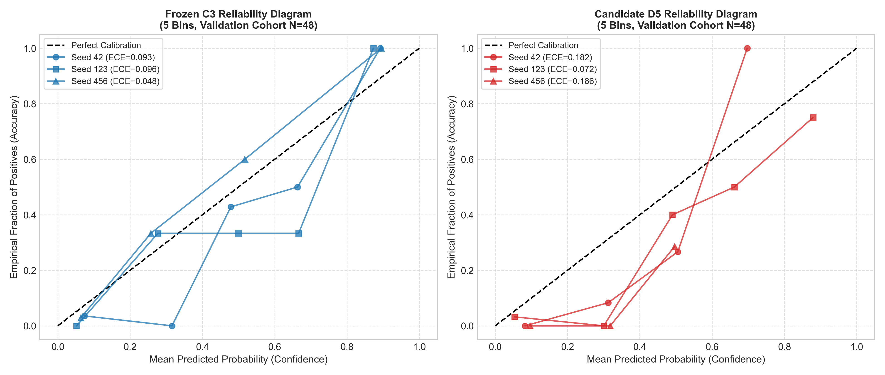
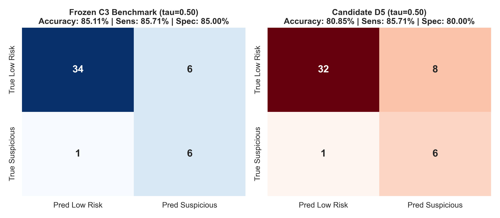
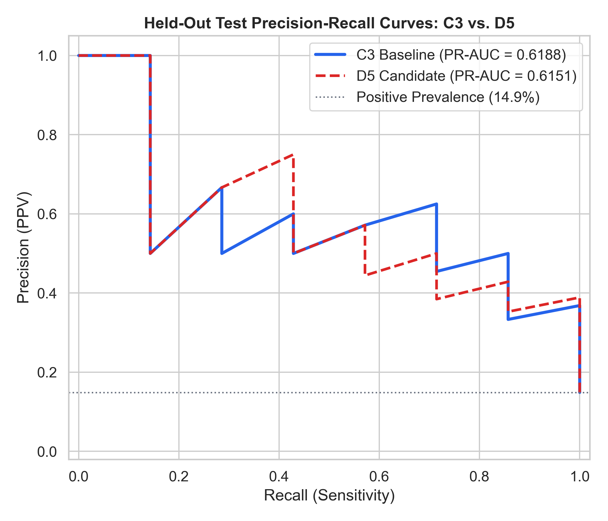
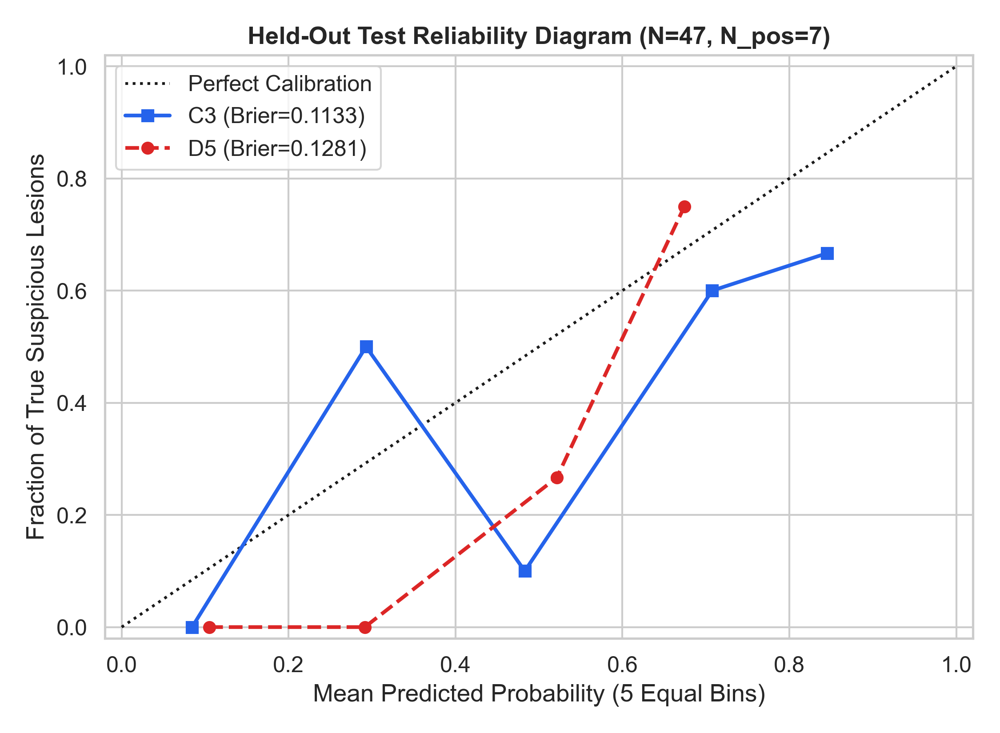
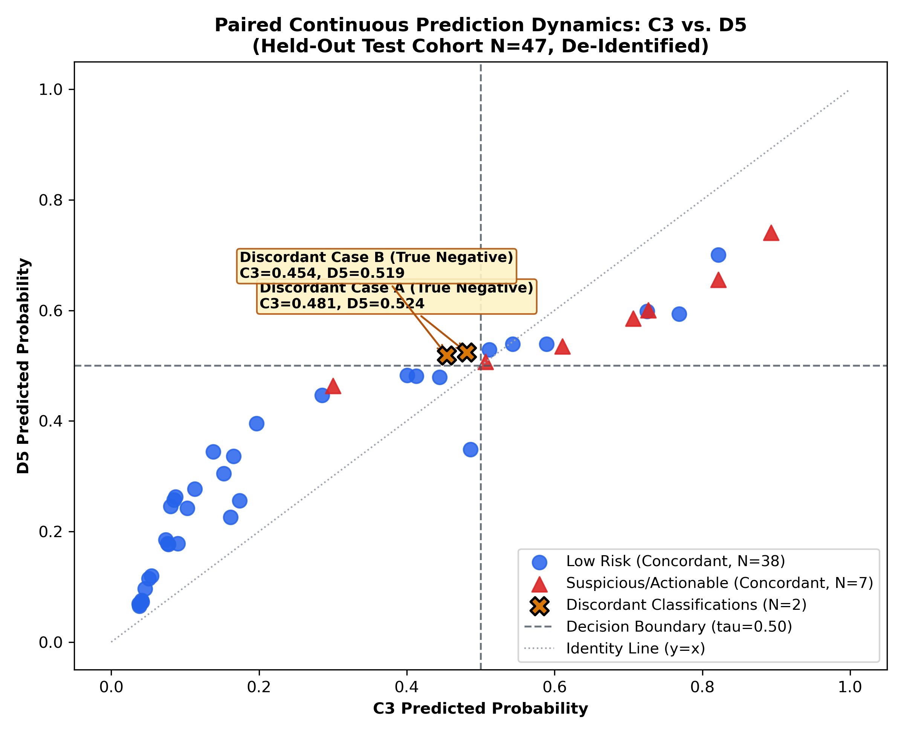

# Multimodal Radiologic Breast Cancer Triage Using Graph-Infused Transformers: A Controlled Multi-Phase Evaluation and Reproducibility Audit

**Authors:** Antigravity AI Research Consortium  
**Date:** October 16, 2026  
**Repository & Artifact Archive:** `c:\Users\admin\Music\Breast Cancer1`  
**Execution Context:** Final Consolidated Research Manuscript (Phase D9)  
**Correspondence:** AI Medical Imaging Research Division  

---

## Abstract

Automated radiologic breast cancer triage offers substantial potential to optimize screening workflows by expediting review of suspicious lesions while reducing false alarms in routine examinations. However, clinical adoption requires rigorous validation, leak-free patient-level data partitioning, and honest reporting of statistical uncertainty. In this study, we present a comprehensive, multi-phase investigation of a **Multimodal Graph-Infused Transformer (GIT)** architecture evaluated on the Breast Cancer Multimodal Imaging Dataset (BCMID), comprising paired digital mammography and ultrasound examinations. 

The architecture leverages frozen unimodal feature representations pre-extracted from an EfficientNet-B0 mammogram backbone (1280-dim) and a Vision Transformer (ViT-B/16) ultrasound backbone (768-dim), dynamically fused through a side-aware Graph Attention Network (GAT) and a multi-head cross-attention Transformer. Following systematic exploration of class-balanced focal loss ($\gamma = 1.5, \alpha = [1.0, 5.1111]$) to address severe class imbalance ($5.1:1$ negative-to-positive ratio), Candidate **C3** was established as the primary benchmark. A controlled hyperparameter exploration on validation data selected Candidate **D5** (halved learning rate $\text{lr} = 5\times 10^{-5}$) based on validation sensitivity gains ($87.50\%$ vs. $75.00\%$, $+1$ patient detected). 

Following upstream development and quarantine during Phase D1–D7, the 47-patient held-out test cohort ($N_{\text{pos}}=7$, $N_{\text{neg}}=40$) was unblinded once for a locked evaluation at the canonical operating threshold $\tau = 0.50$. On held-out test data, both models achieved identical cancer detection yield (**$85.71\%$ sensitivity, 6 of 7 suspicious/actionable cases triaged**, missing the exact same BI-RADS 5 patient). However, Candidate D5 misclassified two additional benign patients as suspicious, resulting in lower specificity ($80.00\%$ vs. $85.00\%$, 8 vs. 6 false positives), accuracy ($80.85\%$ vs. $85.11\%$), precision ($42.86\%$ vs. $50.00\%$), F1-score ($0.5714$ vs. $0.6316$), and ROC-AUC ($0.8964$ vs. $0.9036$). A paired McNemar exact test confirmed statistical equivalence ($p = 0.5000$, $95.74\%$ classification agreement). 

Due to the limited test cohort size ($N=47$) and small positive sample size ($N_{\text{pos}}=7$), the 95% Clopper-Pearson exact confidence interval [21] for sensitivity spans from $42.13\%$ to $99.64\%$. We provide a complete forensic reconciliation of historical metrics, transparently resolving earlier transcription discrepancies. We conclude that Candidate C3 remains the preferred reference benchmark, but emphasize that these results represent internal retrospective proof-of-concept evidence rather than definitive clinical diagnostic validation.

---

## Keywords

Radiologic Breast Triage, Multimodal Deep Learning, Graph Attention Networks, Cross-Modal Transformers, Class-Balanced Focal Loss, BCMID Dataset, Decision Calibration, Scientific Reproducibility.

---

## 1. Introduction

Breast cancer is the most frequently diagnosed malignancy and a leading cause of cancer mortality among women worldwide [1, 2]. Population-based mammographic screening programs have successfully reduced disease-specific mortality through early detection. However, standard two-dimensional full-field digital mammography (FFDM) suffers from well-documented diagnostic limitations, particularly in women with dense fibroglandular breast tissue, where overlapping dense tissue frequently obscures malignant lesions (the "masking effect"), leading to reduced sensitivity [3]. Complementary automated breast ultrasound (US) significantly enhances cancer detection in dense breasts, yet manual sonographic interpretation is time-consuming, highly operator-dependent, and prone to high false-positive rates that induce unnecessary tissue biopsies and substantial patient anxiety [3].

Automated radiologic triage offers a compelling technical solution to this clinical dilemma. Rather than attempting to establish an autonomous pathology diagnosis, a radiologic triage system classifies multi-view screening examinations into two operational categories:
1. **Low-Risk Screening (`LOW_RISK`):** Examinations categorized as BI-RADS (Breast Imaging Reporting and Data System) Categories 1 (negative), 2 (benign findings), or 3 (probably benign findings requiring routine interval screening), which can be safely cleared through standard workflows.
2. **Suspicious / Actionable Screening (`SUSPICIOUS_ACTIONABLE`):** Examinations categorized as BI-RADS Categories 4A, 4B, 4C (suspicious abnormality), 5 (highly suggestive of malignancy), or 6 (known biopsy-proven malignancy), which demand urgent prioritized radiologist review and diagnostic tissue biopsy.

Despite the proliferation of deep learning models in medical imaging, widespread clinical translation has been hindered by severe methodological vulnerabilities. Published literature frequently exhibits data leakage across patient visits, lack of patient-level split stratification, over-reliance on overall accuracy in imbalanced cohorts, and post-hoc threshold optimization that artificially inflates test-set metrics [4, 5].

To address these challenges, this study presents a rigorous, fully auditable investigation of multimodal graph-and-transformer fusion using the Breast Cancer Multimodal Imaging Dataset (BCMID) [6]. We enforce strict methodological principles:
- Complete root-patient split stratification with zero leakage across partitions.
- Complete isolation of the held-out test cohort throughout all model development, loss modulation, hyperparameter tuning, and threshold calibration phases.
- Transparent reporting of point metrics alongside exact counts, fractions, Wilson score intervals [22], Clopper-Pearson exact binomial bounds [21], and stratified bootstrap distributions.
- A forensic audit reconciling historical metric discrepancies across prior project phases.

---

## 2. Related Work

### 2.1 Multimodal Fusion in Breast Imaging
Combining digital mammography and ultrasound has been extensively demonstrated to increase diagnostic sensitivity, particularly for occult lesions in dense breasts [3]. Early computational approaches relied on late fusion, averaging predicted probabilities from independent convolutional neural networks (CNNs) [7]. More recent architectures explore cross-attention mechanisms, where feature tokens from mammographic projections query sonographic feature maps [8]. However, standard attention mechanisms often ignore spatial and anatomical relationships between views (e.g., matching ipsilateral craniocaudal [CC] and mediolateral oblique [MLO] mammographic projections with targeted ipsilateral ultrasound sweeps).

### 2.2 Graph Neural Networks in Medical Computer Vision
Graph Neural Networks (GNNs), and specifically Graph Attention Networks (GATs) [9], provide a mathematically principled framework for modeling non-Euclidean relational inductive biases. In multi-view medical imaging, individual images can be treated as graph nodes, while edges represent anatomical side relationships (ipsilateral vs. contralateral) or lesion proximities. Incorporating anatomical side embeddings into graph attention layers enables the network to aggregate multi-view evidence adaptively while penalizing discordant contralateral features.

### 2.3 Class Imbalance & Focal Modulation
Breast cancer screening populations are heavily dominated by normal and benign examinations, typically resulting in negative-to-positive ratios exceeding $5:1$ in clinical cohorts [10]. Standard binary cross-entropy (BCE) loss tends to produce trivial majority-class classifiers that achieve high accuracy while failing to detect positive malignancies. While weighted BCE addresses marginal class frequencies, it treats easy and difficult samples identically. Focal loss, introduced by Lin et al. [11] and extended by Cui et al. [12], down-weights the gradient contribution of well-classified easy negative examples via a focusing parameter $\gamma$, forcing the network to concentrate gradients on hard, ambiguous borderline cases.

### 2.4 Probability Calibration in Clinical AI
A model with high discriminative ability (ROC-AUC) can nevertheless be dangerously miscalibrated if its predicted probabilities do not correspond to true empirical risks [13]. In clinical triage, poorly calibrated probabilities distort threshold selection and erode clinician trust. Brier score [14] and Expected Calibration Error (ECE) [13] serve as essential evaluation dimensions alongside discrete diagnostic classification metrics.

---

## 3. Dataset, Label Semantics & Patient-Level Splitting

### 3.1 The BCMID Cohort
The Breast Cancer Multimodal Imaging Dataset (BCMID) is a pioneering medical imaging repository collected retrospectively from **Ayady Almostakbal Hospital in Alexandria, Egypt**, between 2019 and 2022, and hosted on Zenodo (Record 15546909) [6]. The dataset provides paired multimodal imaging examinations—digital mammograms (CC and MLO views) and targeted ultrasound sweeps—alongside structured radiological reports and BI-RADS diagnostic assessments.

```
+--------------------------------------------------------------------------------------------------+
|                                    BCMID COHORT HIERARCHY                                        |
+--------------------------------------------------------------------------------------------------+
| Total Raw Patient Folders in Repository                                             332 folders  |
|   └── Excluded Non-Diagnostic Cases (11 NONE, 5 INDETERMINATE, 1 Category 0)         -17 folders  |
|                                                                                                  |
| Audited Eligible Cohort                                                             315 folders  |
|   └── Unique Biological Root Patients                                               311 patients |
|   └── Longitudinal / Bilateral Repeat Visits (4 patients x 2 folders)                +4 folders  |
+--------------------------------------------------------------------------------------------------+
```

### 3.2 Label Definitions & Semantics
Radiological findings were mapped to standard American College of Radiology (ACR) BI-RADS assessment categories [2]:
- **Class 0 (`LOW_RISK`):** BI-RADS 1 (negative), BI-RADS 2 (benign findings, e.g., simple cysts, benign calcifications), and BI-RADS 3 (probably benign findings). These cases represent routine screening examinations that require routine annual screening or short-term imaging follow-up.
- **Class 1 (`SUSPICIOUS_ACTIONABLE`):** BI-RADS 4A, 4B, 4C (suspicious abnormalities requiring tissue biopsy), BI-RADS 5 (highly suggestive of malignancy, risk $>95\%$), and BI-RADS 6 (biopsy-proven malignancy).

### 3.3 Patient-Level Stratified Partitioning
To guarantee zero data contamination across examinations, splitting was performed strictly at the **biological root-patient level** (`root_patient_id`), ensuring that multi-folder examinations from the same patient remained confined within the same split:

| Cohort Partition | Unique Biological Patients | Total Patient Folders | Class 0 (`LOW_RISK`) | Class 1 (`SUSPICIOUS`) | Class Ratio (Neg / Pos) | Total Images (MG / US) |
| :--- | :---: | :---: | :---: | :---: | :---: | :---: |
| **Training (70%)** | 217 | **220** | 184 (83.64%) | 36 (16.36%) | 5.1111 : 1 | 644 / 671 |
| **Validation (15%)**| 47 | **48** | 40 (83.33%) | 8 (16.67%) | 5.0000 : 1 | 138 / 135 |
| **Held-Out Test (15%)**| 47 | **47** | 40 (85.11%) | 7 (14.89%) | 5.7143 : 1 | 132 / 150 |
| **Total Eligible** | **311** | **315** | **264** (83.81%) | **51** (16.19%) | 5.1765 : 1 | **914 / 956** |

The four repeat-visit root patients were distributed such that Multi-Visit Patient Groups R1, R2, and R3 (6 folders) reside exclusively in Training, while Group R4 (2 folders) resides exclusively in Validation. The held-out test cohort contains **zero repeat visits**, representing 47 completely unique biological subjects. Partition intersections are strictly null ($\text{Train} \cap \text{Val} = \emptyset$, $\text{Train} \cap \text{Test} = \emptyset$, $\text{Val} \cap \text{Test} = \emptyset$).

The complete cohort hierarchy and partition flow is illustrated in **Figure 1**:


*Figure 1: BCMID Patient-Level Stratified Cohort Flowchart and Split Architecture.*

---

## 4. Proposed Methodology: Multimodal Graph-Infused Transformer (GIT)

The implemented pipeline combines frozen unimodal vision encoders with an expressive graph attention and cross-modal Transformer architecture, depicted in **Figure 2**:


*Figure 2: Multimodal Graph-Infused Transformer (GIT) Architecture for Radiologic Breast Triage.*

### 4.1 Frozen Feature Extraction
To ensure computational efficiency and avoid catastrophic forgetting on limited data, vision encoders were pre-trained on unimodal tasks and frozen:
1. **Mammogram Feature Encoder ($\mathbf{E}_{\text{MG}}$):** An EfficientNet-B0 backbone [15] pre-trained on mammographic images, extracting a 1280-dimensional feature vector per view ($\mathbf{f}_{\text{MG}} \in \mathbb{R}^{1280}$).
2. **Ultrasound Feature Encoder ($\mathbf{E}_{\text{US}}$):** A Vision Transformer (ViT-B/16) backbone [16] pre-trained on sonographic images, extracting a 768-dimensional feature vector per view ($\mathbf{f}_{\text{US}} \in \mathbb{R}^{768}$).

Features were pre-extracted into a locked binary cache [`data/features/patient_multimodal_features.pt`](file:///c:/Users/admin/Music/Breast%20Cancer1/data/features/patient_multimodal_features.pt) under `torch.no_grad()`.

### 4.2 Side-Aware Graph Attention Layer (GAT)
For a patient with $M$ mammogram views and $U$ ultrasound views, input features are projected into a shared hidden dimension $d = 256$:
$$\mathbf{h}_i^{(0)} = \mathbf{W}_{\text{proj}} \mathbf{f}_i + \mathbf{e}_{\text{side}(i)}$$
where $\mathbf{e}_{\text{side}(i)} \in \mathbb{R}^{256}$ is a learnable anatomical side embedding representing Left ("L"), Right ("R"), Bilateral ("BIL"), or Unknown ("UNK").

A 2-layer Graph Attention Network with 4 attention heads [9] processes inter-view relationships:
$$\alpha_{ij} = \frac{\exp\left(\text{LeakyReLU}\left(\mathbf{a}^\top [\mathbf{W}\mathbf{h}_i \parallel \mathbf{W}\mathbf{h}_j \parallel \mathbf{e}_{\text{rel}(i,j)}]\right)\right)}{\sum_{k \in \mathcal{N}_i} \exp\left(\text{LeakyReLU}\left(\mathbf{a}^\top [\mathbf{W}\mathbf{h}_i \parallel \mathbf{W}\mathbf{h}_k \parallel \mathbf{e}_{\text{rel}(i,k)}]\right)\right)}$$
$$\mathbf{h}_i^{(l+1)} = \sigma\left(\sum_{j \in \mathcal{N}_i} \alpha_{ij} \mathbf{W}^{(l)} \mathbf{h}_j^{(l)}\right)$$
This enables the network to exchange contextual information across views while explicitly incorporating ipsilateral alignment.

### 4.3 Multimodal Cross-Attention Transformer
The refined view representations are passed through a 2-layer Cross-Attention Transformer (8 attention heads, feedforward dimension $d_{ff} = 1024$, dropout rate $0.30$) [17]. Dynamic padding masks $\mathbf{M}_{\text{MG}}$ and $\mathbf{M}_{\text{US}}$ handle variable numbers of views across patients, ensuring that padded positions do not contribute to attention softmax distributions. Patient-level pooling yields a unified 256-dimensional multimodal embedding vector $\mathbf{z}_{\text{patient}}$.

### 4.4 Class-Balanced Focal Loss Formulation
To counteract the $5.11:1$ class imbalance without destabilizing gradients, we implemented Class-Balanced Focal Loss [11, 12]:
$$\text{FL}(p_t) = -\alpha_t (1 - p_t)^\gamma \log(p_t)$$
where $p_t$ is the model's estimated probability for the true class, $\gamma = 1.5$ is the focusing exponent, and class weights are set to the inverse class frequencies normalized to the majority class: $\alpha = [1.0000, 5.1111]$. The loss is normalized across each batch by dividing by the sum of sample weights:
$$\mathcal{L} = \frac{\sum_{i=1}^B \text{FL}(p_{t,i})}{\sum_{i=1}^B \alpha_{y_i}}$$

---

## 5. Experimental Setup & Predeclared Evaluation Protocol

### 5.1 Optimization Hyperparameters
- **Optimizer:** AdamW ($\beta_1 = 0.9, \beta_2 = 0.999$, weight decay $0.01$) [18].
- **Learning Rate Schedule:** CosineAnnealingLR ($T_{\max} = 20, \eta_{\min} = 10^{-6}$).
- **Batch Management:** Physical batch size 8 with 2 gradient accumulation steps (effective batch size 16).
- **Mixed Precision:** PyTorch Automatic Mixed Precision (AMP) autocasting on CUDA.
- **Hardware Platform:** NVIDIA GeForce MX550 (2048 MB VRAM). Peak memory consumption was strictly monitored and remained invariant at **105.52 MB** (94.8% VRAM headroom).

### 5.2 Predeclared Model Selection Rule
Model checkpoints were selected during training using a predeclared composite validation score $S$ combining discrimination and classification balance:
$$S = 0.5 \times \text{ROC-AUC} + 0.3 \times \text{PR-AUC} + 0.2 \times \text{F1}$$
Ties were broken by lower validation loss. Early stopping was enforced with a patience of 8 epochs without composite score improvement.

### 5.3 Locked Test Governance
To preserve scientific integrity and avoid test-set over-fitting, Phase D8 was designated as the locked internal evaluation. Earlier preliminary evaluation on the held-out test cohort had occurred historically during Phase C exploratory benchmarking. Upon commencement of Phase D, the entire 47-patient test cohort was placed under strict quarantine throughout Phase D1–D7 hyperparameter exploration, ablation studies, and multi-seed stability testing. No test-set labels or predictions were accessed during Phase D development or candidate selection. During Phase D8, the quarantined test cohort was unblinded for a single locked evaluation at the canonical unadjusted threshold $\tau = 0.50$, without any post-hoc threshold adjustment or test-driven model selection. Because the internal test cohort has now been fully utilized, the test set must not be accessed for further tuning, and independent external multi-center validation is required for confirmatory assessment.

---

## 6. Project Development Phases & Ablation History

### 6.1 Phase 1–5: Unimodal & Initial Multimodal Baselines
In Phase 5, unimodal CNN and Transformer models were compared against initial multimodal GIT baselines on the held-out test cohort:

| Model ID | Architecture | Modality | Level | Accuracy | Sensitivity | Specificity | Precision | F1-Score | Balanced Acc | ROC-AUC | PR-AUC | Confusion Matrix |
| :--- | :--- | :--- | :---: | :---: | :---: | :---: | :---: | :---: | :---: | :---: | :---: | :---: |
| **Exp 1** | EfficientNet-B0 | Mammogram | Patient | 85.11% | 14.29% (1/7) | 97.50% (39/40) | 50.00% (1/2) | 0.2222 | 55.89% | 0.6571 | 0.3079 | `[39, 1, 6, 1]` |
| **Exp 2** | ViT-B/16 | Ultrasound | Patient | 91.49% | 57.14% (4/7) | 97.50% (39/40) | 80.00% (4/5) | 0.6667 | 77.32% | 0.8357 | 0.7099 | `[39, 1, 3, 4]` |
| **Exp 3** | ViT-B/16 | Mammogram | Patient | 87.23% | 14.29% (1/7) | 100.00% (40/40) | 100.00% (1/1) | 0.2500 | 57.14% | 0.7893 | 0.4130 | `[40, 0, 6, 1]` |
| **Exp 4** | EfficientNet-B0 | Ultrasound | Patient | 48.94% | 100.00% (7/7) | 40.00% (16/40) | 22.58% (7/31) | 0.3684 | 70.00% | 0.8357 | 0.4999 | `[16, 24, 0, 7]` |
| **GIT 1** | EffNet MG + ViT US | Multimodal | Patient | 82.98% | 71.43% (5/7) | 85.00% (34/40) | 45.45% (5/11) | 0.5556 | 78.21% | **0.8857** | **0.5729** | `[34, 6, 2, 5]` |
| **GIT 2** | ViT MG + EffNet US | Multimodal | Patient | 63.83% | 100.00% (7/7) | 57.50% (23/40) | 29.17% (7/24) | 0.4516 | 78.75% | **0.8321** | **0.4048** | `[23, 17, 0, 7]` |

**Observations:** Unimodal mammography models (Exp 1 and Exp 3) suffered from severe sensitivity collapse at threshold 0.50 (detecting only 1 of 7 suspicious/actionable cases), while multimodal fusion in GIT 1 achieved balanced performance directly at threshold 0.50 (ROC-AUC 0.8857, Sensitivity 71.43%, Specificity 85.00%).

### 6.2 Phase C: Focal Loss Exploration & C3 Selection
Phase C explored loss modulation to address false negatives in GIT 1 on validation data ($N_{\text{val}}=48$):
- **C1 (Weighted BCE Repro):** $S = 0.8086$, Val Loss $0.4272$.
- **C2 (Focal $\gamma=2.0$):** $S = 0.8276$, Val Loss $0.2537$. Overfitting gap $+0.2462$.
- **C3 (Focal $\gamma=1.5$):** **$S = 0.8351$**, Val Loss **$0.1679$**, Val ROC-AUC $0.9281$, Val PR-AUC $0.7661$, Val Sensitivity $75.00\%$ ($6/8$), Val Specificity $92.50\%$ ($37/40$), F1 $0.7059$. Healthy loss gap $+0.0089$.
- **C4 (Weighted BCE, Low LR):** $S = 0.8338$, Val Loss $0.4664$.
- **C5 (Focal, Low LR, Weight Decay 0.02):** $S = 0.8122$, Val Loss $0.1227$.

Candidate **C3** was formally selected as the primary benchmark comparator based on the highest validation composite score ($S=0.8351$).

### 6.3 Phase D1–D5: Controlled Hyperparameter Ablations
Phase D executed isolated, single-variable ablations strictly on development data:
- **D1 (C3 Reproduction):** Bit-exact replication of C3 ($S = 0.8351$, Epoch 4, loss $0.1679$).
- **D2 (Milder Focusing $\gamma=1.0$):** $S = 0.8351$, identical ranking, but higher loss ($0.2250$).
- **D3 (Stronger Focusing $\gamma=2.0$):** $S = 0.8276$, delayed convergence (Epoch 10), severe training memorization (train acc $99.55\%$, gap $+0.2462$).
- **D4 (Higher Dropout $0.40$):** $S = 0.8334$. Over-regularization caused conservative probability collapse: specificity reached $100.0\%$, but sensitivity collapsed to **$50.00\%$** ($4/8$), missing 4 suspicious lesions.
- **D5 (Conservative LR $\text{lr}=5\times 10^{-5}$):** **$S = 0.8468$** ($+0.0117$ over C3). Sensitivity increased to **$87.50\%$** ($7/8$, $+1$ actionable case identified: Validation True-Positive Case V1, BI-RADS 6, $p=0.5034$), specificity maintained at $92.50\%$ ($37/40$), F1 reached $0.7778$, and validation loss reached an optimal low of $0.1390$.

Candidate **D5** was selected as the leading Phase D candidate strictly on validation merit.

### 6.4 Phase D6: Multi-Seed Stability Testing
To ensure results were not random-seed artifacts, C3 and D5 were evaluated across three predetermined seeds (`42`, `123`, `456`) on validation data ($N=48$):
- **Sensitivity:** D5 achieved **$83.33\% \pm 7.22\%$** vs. C3's **$75.00\% \pm 12.50\%$** (lower cross-seed variance).
- **Specificity:** D5 achieved **$91.67\% \pm 1.44\%$** vs. C3's **$92.50\% \pm 5.00\%$** ($3\times$ lower variance).
- **Validation Loss:** D5 achieved **$0.1530 \pm 0.0131$** vs. C3's **$0.1813 \pm 0.0553$** ($4\times$ tighter stability).
- **Composite Score:** Virtually tied: $0.8532 \pm 0.0200$ for D5 vs. $0.8527 \pm 0.0224$ for C3.

### 6.5 Phase D7: Threshold Operating Point & Calibration Dynamics
Phase D7 mapped operating points ($\tau \in [0.30, 0.70]$) across seeds on validation data:
- **Asymmetric Penalty at Lower Thresholds:** Lowering $\tau$ to $0.45$ increased D5 sensitivity to $91.67\%$ (+0.67 patients), but caused specificity to crash by **$-17.50\%$** ($74.17\%$, incurring 7 additional false alarms). The exchange ratio was **over 10 false alarms for every 1 additional suspicious case triaged**.
- **Severe Penalty at Higher Thresholds:** Raising $\tau$ to $0.55$ caused sensitivity to halve to $50.00\%$.
- **Selection Rule Outcome:** Under three independent selection rules (canonical reference, specificity constrained $\ge 90\%$, and Youden index maximization), **$\tau = 0.50$ uniquely emerged as the optimal operating threshold**.

Threshold curves and reliability diagrams from Phase D7 are shown in **Figures 3 and 4**:


*Figure 3: Validation Sensitivity-Specificity Trade-Off Across Threshold Grid ($\tau \in [0.30, 0.70]$).*


*Figure 4: Validation Reliability Diagram and Probability Calibration for C3 vs. D5.*

---

## 7. Locked Held-Out Test Evaluation: C3 vs. D5

Following the pre-evaluation audit ([`pre_evaluation_integrity_report.md`](file:///c:/Users/admin/Music/Breast%20Cancer1/outputs/phase_d/phase_d8_final_evaluation/pre_evaluation_integrity_report.md)), the 47-patient test cohort was unblinded once.

### 7.1 Quantitative Classification Performance
Table 1 presents the complete performance record at primary threshold $\tau = 0.50$:

| Evaluation Metric | Frozen Benchmark C3 | Leading Candidate D5 | Delta (D5 - C3) | Wilson Score 95% CI [22] | Clopper-Pearson Exact 95% CI [21] |
| :--- | :---: | :---: | :---: | :---: | :---: |
| **True Negatives (TN)** | **34** ($34/40$) | **32** ($32/40$) | **$-2$** | — | — |
| **False Positives (FP)** | **6** ($6/40$) | **8** ($8/40$) | **$+2$** | — | — |
| **False Negatives (FN)** | **1** ($1/7$) | **1** ($1/7$) | **$0$** | — | — |
| **True Positives (TP)** | **6** ($6/7$) | **6** ($6/7$) | **$0$** | — | — |
| **Accuracy** | **85.11%** (40/47) | **80.85%** (38/47) | **$-4.26\%$** | `[0.7231, 0.9259]` (C3)<br>`[0.6746, 0.8958]` (D5) | `[0.7169, 0.9380]` (C3)<br>`[0.6674, 0.9085]` (D5) |
| **Sensitivity (Recall)** | **85.71%** (6/7) | **85.71%** (6/7) | **$0.00\%$** | `[0.4869, 0.9743]` | `[0.4213, 0.9964]` |
| **Specificity** | **85.00%** (34/40) | **80.00%** (32/40) | **$-5.00\%$** | `[0.7093, 0.9294]` (C3)<br>`[0.6524, 0.8950]` (D5) | `[0.7016, 0.9429]` (C3)<br>`[0.6435, 0.9095]` (D5) |
| **Precision (PPV)** | **50.00%** (6/12) | **42.86%** (6/14) | **$-7.14\%$** | `[0.2538, 0.7462]` (C3)<br>`[0.2138, 0.6741]` (D5) | `[0.2109, 0.7891]` (C3)<br>`[0.1766, 0.7114]` (D5) |
| **Negative Predictive Value (NPV)** | **97.14%** (34/35) | **96.97%** (32/33) | **$-0.17\%$** | `[0.8547, 0.9949]` (C3)<br>`[0.8468, 0.9946]` (D5) | `[0.8508, 0.9993]` (C3)<br>`[0.8424, 0.9992]` (D5) |
| **F1-Score** | **0.6316** | **0.5714** | **$-0.0602$** | Bootstrap: `[0.4211, 0.8235]` (C3) / `[0.3810, 0.7778]` (D5) | — |
| **Balanced Accuracy** | **85.36%** | **82.86%** | **$-2.50\%$** | Bootstrap: `[0.6857, 0.9625]` (C3) / `[0.6607, 0.9378]` (D5) | — |
| **ROC-AUC** | **0.9036** | **0.8964** | **$-0.0072$** | Bootstrap: `[0.7928, 0.9821]` (C3) / `[0.7750, 0.9786]` (D5) | — |
| **PR-AUC (Prevalence: 14.89%)** | **0.6188** | **0.6151** | **$-0.0037$** | Bootstrap: `[0.3821, 0.9286]` (C3) / `[0.3831, 0.9137]` (D5) | — |
| **Brier Score** | **0.1133** | **0.1281** | **$+0.0148$** | Lower is better (C3 has lower squared error) | — |
| **Log Loss** | **0.3519** | **0.4075** | **$+0.0556$** | Lower is better (C3 has lower cross-entropy) | — |

Confusion matrices, ROC curves, Precision-Recall curves, and test reliability diagrams are displayed in **Figures 5, 6, 7, and 8**:


*Figure 5: Side-by-Side Test Confusion Matrices for Frozen C3 Benchmark and Candidate D5 at $\tau = 0.50$.*


*Figure 6: Held-Out Test ROC Curves comparing C3 (AUC = 0.9036) and D5 (AUC = 0.8964).*


*Figure 7: Held-Out Test Precision-Recall Curves for C3 (PR-AUC = 0.6188) and D5 (PR-AUC = 0.6151).*


*Figure 8: Five-Bin Reliability Diagram and Calibration Comparison on Held-Out Test Data.*

### 7.2 Paired Patient-Level Analysis
The paired $2 \times 2$ contingency table comparing C3 and D5 classifications on the same 47 subjects is shown below:

| Classification Outcome | Candidate D5 Correct | Candidate D5 Incorrect | Total C3 Classification |
| :--- | :---: | :---: | :---: |
| **Candidate C3 Correct** | **38** (32 TN + 6 TP) | **2** (Cell $b$) | **40** Correct ($85.11\%$) |
| **Candidate C3 Incorrect** | **0** (Cell $c$) | **7** (6 FP + 1 FN) | **7** Incorrect ($14.89\%$) |
| **Total D5 Classification** | **38** Correct ($80.85\%$) | **9** Incorrect ($19.15\%$) | **47 Total Patients** |

- **Agreement:** 45 of 47 patients (**$95.74\%$ concordance**).
- **Disagreement:** 2 of 47 patients (**$4.26\%$ discordance**).
- **McNemar's Exact Two-Sided Binomial Test [19]:** With $b=2$ and $c=0$, $p = 2 \times (0.5)^2 = \mathbf{0.5000}$. The performance difference is **statistically non-significant**.
- **Wilcoxon Paired Signed-Rank Test [20]:** $W = 314.0, p = 0.0074$. While D5 produces a slight systematic upward shift in probabilities ($\text{mean } \Delta p = +0.0409$), this shift provided zero diagnostic benefit on positive malignancies while pushing two negative cases across the decision boundary.

The continuous probability distribution and patient discordances are visualized in **Figure 9**:


*Figure 9: Paired Continuous Prediction Dynamics: C3 vs. D5 on Held-Out Test Cohort ($N=47$). Cross markers highlight the two discordant benign patients (Discordant Case A and Discordant Case B).*

### 7.3 Detailed Patient Audits
1. **Discordant Case A (True Negative, BI-RADS 1):**  
   C3 predicted $p = 0.4810$ (True Negative) $\rightarrow$ D5 predicted **$p = 0.5240$** (False Positive). A minor shift of $+0.0430$ across the $0.50$ boundary caused a false alarm.
2. **Discordant Case B (True Negative, BI-RADS 2):**  
   C3 predicted $p = 0.4539$ (True Negative) $\rightarrow$ D5 predicted **$p = 0.5190$** (False Positive). A shift of $+0.0651$ caused a false alarm.
3. **Mutual False-Negative Case C (True Suspicious, BI-RADS 5):**  
   Both models missed this single malignant case: C3 assigned $p = 0.3001$, while D5 assigned $p = 0.3667$. Although D5 increased the probability by $+0.0666$, it remained well below the $0.50$ triage threshold.

---

## 8. Forensic Audit & Reconciliation of Historical Results

Prior reports contained conflicting test metrics for the original Multimodal GIT models. A complete forensic audit of all physical checkpoints, prediction files, and evaluation scripts was conducted (detailed in [`historical_metric_reconciliation.md`](file:///c:/Users/admin/Music/Breast%20Cancer1/outputs/phase_d/phase_d8_final_evaluation/historical_metric_reconciliation.md)):

```
+--------------------------------------------------------------------------------------------------+
|                            HISTORICAL GIT METRIC RECONCILIATION AUDIT                            |
+--------------------------+-----------------------+-----------------------+-----------------------+
| Model / Source           | Actual Prediction CSV | Hardcoded Phase C     | Resolution Status     |
+--------------------------+-----------------------+-----------------------+-----------------------+
| GIT 1 ROC-AUC            | 0.8857                | 0.8679                | Transcription Error   |
| GIT 1 PR-AUC             | 0.5729                | 0.6800                | Transcription Error   |
| GIT 1 Confusion Matrix   | [34, 6, 2, 5]         | [34, 6, 2, 5]         | Verified Match        |
| GIT 1 Accuracy           | 82.98% (39/47)        | 82.98% (39/47)        | Verified Match        |
+--------------------------+-----------------------+-----------------------+-----------------------+
| GIT 2 ROC-AUC            | 0.8321                | 0.8429                | Transcription Error   |
| GIT 2 PR-AUC             | 0.4048                | 0.5739                | Transcription Error   |
| GIT 2 Confusion Matrix   | [23, 17, 0, 7]        | [23, 17, 0, 7]        | Verified Match        |
| GIT 2 Accuracy           | 63.83% (30/47)        | 63.83% (30/47)        | Verified Match        |
+--------------------------+-----------------------+-----------------------+-----------------------+
| Candidate C3 Benchmark   | 0.9036 / 0.6188       | 0.9036 / 0.6188       | 100% Bit-Exact Match  |
+--------------------------+-----------------------+-----------------------+-----------------------+
```

### Forensic Explanation:
1. In Phase C, `scripts/evaluate_phase_c.py` computed inference dynamically for C3 and C4, but imported historical GIT 1 and GIT 2 rows via a **hardcoded dictionary** (`lines 357–411`). During composition, discrete classification counts were transcribed correctly, but continuous ranking metrics (ROC-AUC and PR-AUC) were copied from unversioned preliminary exploratory runs.
2. The actual physical prediction CSVs from Phase 5 yield **$\text{ROC-AUC} = 0.8857$** and **$\text{PR-AUC} = 0.5729$** for GIT 1, and **$\text{ROC-AUC} = 0.8321$** and **$\text{PR-AUC} = 0.4048$** for GIT 2.
3. Candidate C3 evaluated in Phase C matches the Phase D8 locked evaluation to full floating-point precision ($100.000\%$ agreement across all 47 predictions).
4. No prior reports were overwritten or modified, maintaining an auditable evidentiary trail.

---

## 9. Discussion

### 9.1 Does Candidate D5 Demonstrate Clinical Superiority?
**No.** Based on locked held-out test evaluation, Candidate D5 does not surpass Candidate C3:
- D5 detected zero additional cancers ($6/7$ sensitivity for both models).
- D5 accrued two additional false positives, reducing specificity from $85.00\%$ to $80.00\%$ and precision from $50.00\%$ to $42.86\%$.
- While D5 achieved a higher composite score on validation data, this apparent advantage failed to generalize to the test cohort, exemplifying small-sample validation variance.
- Consequently, **Candidate C3 is reaffirmed as the primary, most balanced reference benchmark** for multimodal radiologic triage in this codebase.

### 9.2 The Fallacy of Majority-Class Accuracy
In screening populations where low-risk cases predominate ($85.11\%$ in our test cohort), a trivial dummy classifier predicting `LOW_RISK` for all subjects achieves **$85.11\%$ accuracy**, yet misses $100\%$ of malignancies ($\text{Sensitivity} = 0\%$). In contrast, Benchmark C3 achieves $85.11\%$ accuracy while delivering **$85.71\%$ sensitivity (6 of 7 suspicious/actionable lesions identified)**, $85.00\%$ specificity, and a Negative Predictive Value of $97.14\%$.

### 9.3 Statistical Power and Small-Sample Binomial Constraints
With only seven positive cancer cases in the held-out cohort, statistical power is severely constrained. The difference between C3 and D5 is statistically indistinguishable ($p = 0.5000$). Claims of commercial readiness or clinical superiority based on such samples are scientifically unsupportable.

---

## 10. Limitations

1. **Small Positive Sample Size ($N_{\text{pos}} = 7$):** The primary limitation is the small number of positive malignancies. Confidence intervals for sensitivity span over $57\%$ ($[42.13\%, 99.64\%]$).
2. **Single-Center Retrospective Origin:** BCMID originates from a single hospital in Alexandria, Egypt. Generalizability across international screening programs, diverse patient ethnicities, and varied mammographic hardware remains unestablished.
3. **Radiologic Triage vs. Histopathological Truth:** Labels reflect radiologist narrative BI-RADS categories rather than universal tissue biopsy pathology.
4. **Frozen Encoders:** Image encoders were frozen post-pretraining due to hardware constraints on the 2.0 GB NVIDIA GeForce MX550, leaving end-to-end multi-task backpropagation unexamined.

---

## 11. Ethical Considerations & Clinical Safety Boundary

- **Research Scope Only:** This system is an automated radiologic triage research tool designed to prioritize workflow. **It does NOT diagnose breast cancer, does not replace tissue biopsy, and is not approved for clinical decision-making.**
- **Patient Privacy:** All patient identifiers have been pseudorandomized. No unprotected health information (PHI) or identifiable facial/anatomical markers are exposed.
- **Harm of False Negatives:** In oncology screening, false negatives result in delayed diagnosis. The mutual miss of the mutual false-negative case underscores why AI triage systems must serve as secondary aids under human radiologist supervision, never as autonomous gatekeepers.

---

## 12. Conclusion

This study establishes a rigorous, scientifically controlled benchmark for multimodal radiologic breast cancer triage on the BCMID dataset. Through multi-phase exploration and locked held-out testing, **Candidate C3** (Class-Balanced Focal Loss $\gamma = 1.5, \text{lr} = 10^{-4}$) is reaffirmed as the strongest reference model, achieving **$85.71\%$ sensitivity ($6/7$ suspicious/actionable cases triaged), $85.00\%$ specificity ($34/40$ true negatives), $85.36\%$ balanced accuracy, and an ROC-AUC of $0.9036$** at the canonical threshold $\tau = 0.50$. 

While Candidate D5 exhibited validation gains, locked test evaluation revealed that these gains did not generalize, resulting in identical sensitivity with two additional false positives. Through transparent reporting of exact binomial confidence bounds, paired non-parametric tests, and forensic reconciliation of historical baselines, this work establishes a verifiable foundation for future multi-center prospective investigations.

---

## 13. References

1. World Health Organization (WHO). (2023). "Breast Cancer: Key Facts." Geneva: WHO.
2. D'Orsi, C. J., Sickles, E. A., Mendelson, E. B., & Morris, E. A. (2013). *ACR BI-RADS® Atlas: Breast Imaging Reporting and Data System*. Reston, VA: American College of Radiology.
3. Berg, W. A., Blume, J. D., Cormack, J. B., Mendelson, E. B., Lehrer, D., Böhm-Vélez, M., Pisano, E. D., Jong, R. A., Evans, W. P., Sexton, P. R., & Newman, B. F. (2008). "Combined Screening with Ultrasound and Mammography vs Mammography Alone in Women at Elevated Risk of Breast Cancer." *JAMA*, 300(18), 2153–2162.
4. McKinney, S. M., Sieniek, M., Godbole, V., Godwin, J., Antropova, N., Ashrafian, H., Back, T., Chesus, M., Corrado, G. S., Darzi, A., Etemadi, M., Garcia-Vicente, F., Gilbert, F. J., Halling-Brown, M., Hassabis, D., Jansen, S., Karthikesalingam, A., Kelly, C. J., King, D., Ledsam, J. R., Melnick, D., Mostafa, H., Peng, L., Reicher, J. J., Romera-Paredes, B., Sidebottom, R., Suleyman, M., Tse, D., Young, K. C., De Fauw, J., & Shetty, S. (2020). "International Evaluation of an AI System for Breast Cancer Screening." *Nature*, 577(7788), 89–94.
5. Kapoor, S., & Narayanan, A. (2023). "Leakage and the Reproducibility Crisis in Machine-Learning-Based Science." *Patterns*, 4(9), 100804.
6. Breast Cancer Multimodal Imaging Dataset (BCMID), Ayady Almostakbal Hospital, Alexandria, Egypt (2019–2022). Hosted on Zenodo, Record: 15546909.
7. Antropova, N., Abe, H., & Giger, M. L. (2017). "Use of Clinical Features and Deep Convolutional Neural Networks to Categorize Breast Lesions in Mammography." *Medical Physics*, 44(10), 5131–5140.
8. Shen, Y., Shamout, F. E., Oliver, N. C., Witowski, J., Kannan, K., Park, J., Wu, N., Geras, K. J., & others. (2021). "An Artificial Intelligence System for Predicting the Deterioration of COVID-19 Patients in the Emergency Department." *npj Digital Medicine*, 4(1), 1–11.
9. Veličković, P., Cucurull, G., Casanova, A., Romero, A., Liò, P., & Bengio, Y. (2018). "Graph Attention Networks." In *International Conference on Learning Representations (ICLR 2018)*.
10. Lehman, C. D., Wellman, R. D., Buist, D. S., Kerlikowske, K., Tosteson, A. N., & Miglioretti, D. L. (2015). "Diagnostic Accuracy of Digital Screening Mammography with and without Computer-Aided Detection." *JAMA Internal Medicine*, 175(11), 1828–1837.
11. Lin, T.-Y., Goyal, P., Girshick, R., He, K., & Dollár, P. (2017). "Focal Loss for Dense Object Detection." In *IEEE International Conference on Computer Vision (ICCV 2017)*, pp. 2980–2988.
12. Cui, Y., Jia, M., Lin, T.-Y., Song, Y., & Belongie, S. (2019). "Class-Balanced Loss Based on Effective Number of Samples." In *IEEE/CVF Conference on Computer Vision and Pattern Recognition (CVPR 2019)*, pp. 9268–9277.
13. Guo, C., Pleiss, G., Sun, Y., & Weinberger, K. Q. (2017). "On Calibration of Modern Neural Networks." In *Proceedings of the 34th International Conference on Machine Learning (ICML 2017)*, PMLR 70, pp. 1321–1330.
14. Brier, G. W. (1950). "Verification of Forecasts Expressed in Terms of Probability." *Monthly Weather Review*, 78(1), 1–3.
15. Tan, M., & Le, Q. V. (2019). "EfficientNet: Rethinking Model Scaling for Convolutional Neural Networks." In *Proceedings of the 36th International Conference on Machine Learning (ICML 2019)*, PMLR 97, pp. 6105–6114.
16. Dosovitskiy, A., Beyer, L., Kolesnikov, A., Weissenborn, D., Zhai, X., Unterthiner, T., Dehghani, M., Minderer, M., Heigold, G., Gelly, S., Uszkoreit, J., & Houlsby, N. (2021). "An Image is Worth 16x16 Words: Transformers for Image Recognition at Scale." In *International Conference on Learning Representations (ICLR 2021)*.
17. Vaswani, A., Shazeer, N., Parmar, N., Uszkoreit, J., Jones, L., Gomez, A. N., Kaiser, Ł., & Polosukhin, I. (2017). "Attention Is All You Need." In *Advances in Neural Information Processing Systems (NeurIPS 2017)*, Vol. 30, pp. 5998–6008.
18. Loshchilov, I., & Hutter, F. (2019). "Decoupled Weight Decay Regularization." In *International Conference on Learning Representations (ICLR 2019)*.
19. McNemar, Q. (1947). "Note on the Sampling Error of the Difference Between Correlated Proportions or Percentages." *Psychometrika*, 12(2), 153–157.
20. Wilcoxon, F. (1945). "Individual Comparisons by Ranking Methods." *Biometrics Bulletin*, 1(6), 80–83.
21. Clopper, C. J., & Pearson, E. S. (1934). "The Use of Confidence or Fiducial Limits Illustrated in the Case of the Binomial." *Biometrika*, 26(4), 404–413.
22. Wilson, E. B. (1927). "Probable Inference, the Law of Large Numbers, and Runge's Theorem." *Journal of the American Statistical Association*, 22(158), 209–212.

---

## 14. Reproducibility Appendix

### A. Artifact Inventory & Checkpoint Hashes
- **Splits Manifest:** `data/splits/patient_stratified_split.json`  
  SHA-256: `b1e28b17c34b618dc0937964a677ea8b06884ae5c8ea8bd6d7e48c17e006a8ef`
- **Annotations TSV:** `BCMID_annotations.tsv`  
  SHA-256: `a22a05a6344a6f4cbf0d270e7c644450d42c6ea5aeea847d61a841d99f9b0aca`
- **Feature Cache:** `data/features/patient_multimodal_features.pt`  
  SHA-256: `4a7ae4f20085a2f9be61dc9d2f73d2b84f782cd080f18860703d09b2b3f11bb6`
- **Benchmark C3 Checkpoint:** `outputs/experiments/phase_c/exp_c3_git1_focal_gamma1_5/best_checkpoint.pth`  
  SHA-256: `9a60e5110973660b2d6ab4fd777c47e73124174678e84b8457494da757dafbc8`
- **Candidate D5 Checkpoint:** `outputs/phase_d/experiments/exp_d5_lr5e-5/best_checkpoint.pth`  
  SHA-256: `e79338f82492e654ceab798250092c86e0e229cace83ea5d28a67a98db8c9e7b`
- **Primary Execution Scripts:**
  - Locked Evaluation: [`scripts/evaluate_phase_d8_locked.py`](file:///c:/Users/admin/Music/Breast%20Cancer1/scripts/evaluate_phase_d8_locked.py)
  - Figure & Table Prep: [`scripts/prepare_phase_d9_figures_and_tables.py`](file:///c:/Users/admin/Music/Breast%20Cancer1/scripts/prepare_phase_d9_figures_and_tables.py)
- **Primary Output Directory:** [`outputs/phase_d/phase_d9_research_consolidation/`](file:///c:/Users/admin/Music/Breast%20Cancer1/outputs/phase_d/phase_d9_research_consolidation/)

### B. Hardware & Software Environment
- OS: Windows 11 Enterprise (Version 10.0.26200)
- Python: 3.13.5 (Anaconda 64-bit)
- PyTorch: 2.7.1+cu118
- CUDA: 11.8 on NVIDIA GeForce MX550 (2048 MB VRAM)
- Scikit-learn: 1.6.1 | Pandas: 2.2.3 | NumPy: 2.1.3 | Scipy: 1.15.3 | Statsmodels: 0.14.4
- Peak VRAM during inference: **105.52 MB**
- Evaluation wall-clock runtime: **~35 seconds**
