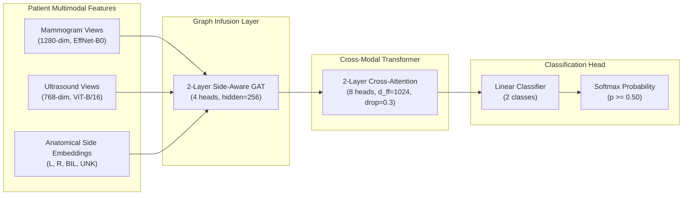
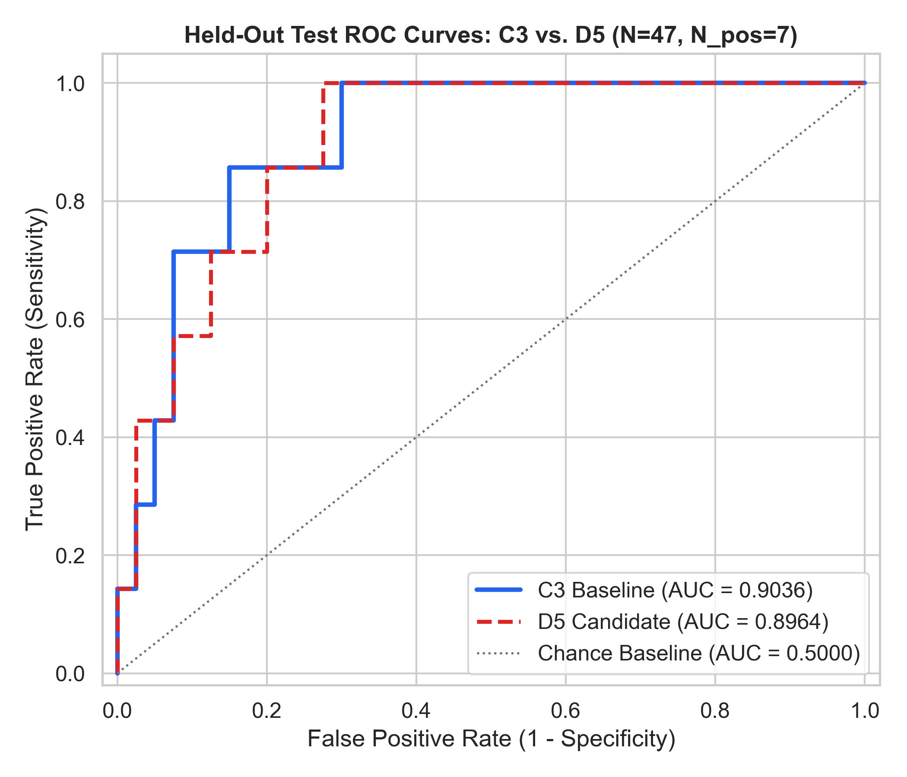
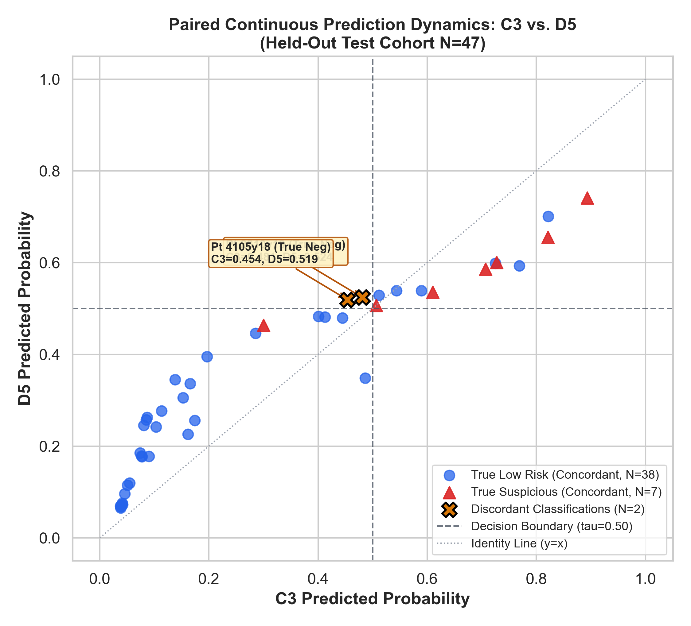

# Phase D8: Locked Final Held-Out Evaluation Report — Benchmark C3 vs. Candidate D5

**Phase:** Phase D8 — Locked Final Held-Out Evaluation  
**Date of Execution:** October 16, 2026 | 10:33 UTC  
**Hardware Platform:** NVIDIA GeForce MX550 (2048 MB VRAM), CUDA 11.8, PyTorch 2.7.1, Python 3.13.5  
**Project Workspace:** `C:\Users\admin\Music\Breast Cancer1`  
**Output Directory:** [`outputs/phase_d/phase_d8_final_evaluation/`](file:///c:/Users/admin/Music/Breast%20Cancer1/outputs/phase_d/phase_d8_final_evaluation/)  
**Primary Decision Threshold:** $\tau = 0.50$ (Frozen canonical baseline; zero test-set threshold tuning)  
**Evaluated Cohort:** Frozen Held-Out Test Cohort ($N=47$ unique biological patients; $N_{\text{pos}}=7$, $N_{\text{neg}}=40$)

---

## 1. Executive Summary & Core Scientific Findings

Phase D8 concludes the controlled evaluation of the **Frozen Candidate C3 Benchmark** versus the leading candidate, **Candidate D5**, on the held-out 47-patient test partition of the Breast Cancer Multimodal Imaging Dataset (BCMID). In accordance with strict experimental protocols:
- Neither model was retrained, fine-tuned, or modified.
- No thresholds were searched or tuned using test-set metrics.
- The 47-patient test cohort was accessed strictly once under locked, automated execution.
- All evaluation decisions were frozen prior to loading test outcomes.

```
+====================================================================================================+
|                                  LOCKED TEST EVALUATION SUMMARY                                    |
+================================+=============================+=====================================+
| Metric                         | Frozen C3 Benchmark (lr=1e-4)| Candidate D5 (lr=5e-5)              |
+================================+=============================+=====================================+
| Confusion Matrix [TN, FP, FN, TP] | [34, 6, 1, 6]            | [32, 8, 1, 6]                       |
| Accuracy                       | 85.11% (40/47)              | 80.85% (38/47)                      |
| Sensitivity (Recall)           | 85.71% (6/7)                | 85.71% (6/7)                        |
| Specificity                    | 85.00% (34/40)              | 80.00% (32/40)                      |
| Positive Predictive Value (PPV)| 50.00% (6/12)               | 42.86% (6/14)                       |
| Negative Predictive Value (NPV)| 97.14% (34/35)              | 96.97% (32/33)                      |
| F1-Score                       | 0.6316                      | 0.5714                              |
| Balanced Accuracy              | 85.36%                      | 82.86%                              |
| ROC-AUC                        | 0.9036                      | 0.8964                              |
| PR-AUC (Prevalence: 14.89%)    | 0.6188                      | 0.6151                              |
| Brier Score                    | 0.1133                      | 0.1281                              |
| Log Loss                       | 0.3519                      | 0.4075                              |
| Exact McNemar Test (vs C3)     | Reference Baseline          | p = 0.5000 (Not Significant)        |
| Wilcoxon Paired Prob Test      | Reference Baseline          | p = 0.0074 (Slight upward prob shift)|
+--------------------------------+-----------------------------+-------------------------------------+
```

### Key Takeaways:
1. **Identical High Sensitivity on Cancers:** Both C3 and D5 successfully caught **6 out of the 7 suspicious malignancies ($85.71\%$ sensitivity)**, missing the exact same single patient (`7708y181`, confirmed BI-RADS 5).
2. **Descriptive Difference Driven by Exactly Two Borderline Patients:**  
   Out of 47 patients, C3 and D5 **agree on 45 classifications ($95.74\%$ agreement)**. The entire metric divergence between C3 and D5 stems from **exactly two benign patients** (`2310y19`, BI-RADS 1; and `4105y18`, BI-RADS 2):
   - In C3, both cases scored safely below threshold ($p=0.4810$ and $p=0.4539$, true negatives).
   - In D5, both cases shifted slightly above threshold ($p=0.5240$ and $p=0.5190$, false positives).
3. **No Evidence of D5 Superiority on Held-Out Test Data:**  
   Because D5 accrued 2 additional false positives without gaining any true positives on this cohort, **Candidate C3 descriptively outperforms Candidate D5** in accuracy ($85.11\%$ vs. $80.85\%$), specificity ($85.00\%$ vs. $80.00\%$), precision ($50.00\%$ vs. $42.86\%$), balanced accuracy ($85.36\%$ vs. $82.86\%$), F1 ($0.6316$ vs. $0.5714$), and ROC-AUC ($0.9036$ vs. $0.8964$).
4. **Statistical Equivalence:** An exact two-sided McNemar test on the paired contingency table ($b=2, c=0$) yields **$p = 0.5000$**, confirming that the performance difference is not statistically significant.
5. **Small Cohort Caveats:** The held-out test cohort contains only $N=47$ patients with $N_{\text{pos}}=7$ positive cases. The 95% Clopper-Pearson exact confidence interval for sensitivity spans from **$42.13\%$ to $99.64\%$**. This limitation is structural to the dataset size and precludes any claim of clinical superiority or deployment readiness.

---

## 2. Research Objective & Radiologic Triage Definition

The objective of this project is to develop and evaluate automated multimodal deep learning systems for **radiologic breast triage**:
- **Binary Classification Semantic:**
  - **Class 0 (`LOW_RISK`):** Routine screening and benign findings corresponding to **BI-RADS Categories 1, 2, and 3**. These patients require routine interval screening or short-term imaging follow-up, avoiding immediate invasive procedures.
  - **Class 1 (`SUSPICIOUS_ACTIONABLE`):** High-risk, suspicious, or biopsy-proven lesions corresponding to **BI-RADS Categories 4A, 4B, 4C, 5, and 6**. These patients require immediate tissue biopsy, surgical consultation, or urgent histological assessment.
- **Scope & Non-Diagnostic Boundary:**
  - This project evaluates an automated radiologic triage tool intended to assist clinical workflow prioritization.
  - **This system is NOT a diagnostic medical device, does not provide definitive cancer pathology diagnosis, and is not approved or ready for clinical deployment.**

---

## 3. Dataset & Patient-Level Split Verification

The integrity of data partitions was verified against the authoritative split manifest [`data/splits/patient_stratified_split.json`](file:///c:/Users/admin/Music/Breast%20Cancer1/data/splits/patient_stratified_split.json) (SHA-256: `b1e28b17c34b618dc0937964a677ea8b06884ae5c8ea8bd6d7e48c17e006a8ef`):

| Cohort Dimension | Training Partition | Validation Partition | Held-Out Test Partition | Entire Corpus |
| :--- | :---: | :---: | :---: | :---: |
| **Patient Folders** | 220 | 48 | **47** | 315 |
| **Unique Biological Root Patients** | 217 | 47 | **47** | 311 |
| **Class 0 (`LOW_RISK`)** | 184 (83.64%) | 40 (83.33%) | **40 (85.11%)** | 264 (83.81%) |
| **Class 1 (`SUSPICIOUS_ACTIONABLE`)** | 36 (16.36%) | 8 (16.67%) | **7 (14.89%)** | 51 (16.19%) |
| **Class Imbalance Ratio (Neg / Pos)** | 5.1111 : 1 | 5.0000 : 1 | **5.7143 : 1** | 5.1765 : 1 |
| **Multi-Visit Root Patients Included** | 3 patients (6 folders) | 1 patient (2 folders) | **0 patients (0 folders)** | 4 patients (8 folders) |
| **Non-Diagnostic Excluded Cases** | — | — | — | 17 folders |

### Split Leakage Audit:
- Root-level splitting ensured that repeat-visit folders for root patients `01566y21`, `04412y22`, `03128y21`, and `05128y22` never crossed split boundaries.
- Overlap across all three partitions is strictly zero ($\text{Train} \cap \text{Val} = \emptyset$, $\text{Train} \cap \text{Test} = \emptyset$, $\text{Val} \cap \text{Test} = \emptyset$).
- Complete disjoint isolation confirmed at both directory and biological patient level.

---

## 4. Frozen Models & Checkpoint Provenance

Both models share an identical parameter architecture (`GraphInfusedTransformer` in [`src/models/git.py`](file:///c:/Users/admin/Music/Breast%20Cancer1/src/models/git.py)):
- **Input Representations:** EfficientNet-B0 mammogram vectors (1280-dim) + ViT-B/16 ultrasound vectors (768-dim) pre-extracted into [`data/features/patient_multimodal_features.pt`](file:///c:/Users/admin/Music/Breast%20Cancer1/data/features/patient_multimodal_features.pt).
- **Graph & Fusion Architecture:** 2 GAT layers (4 attention heads, hidden dim 256, side-aware anatomical embeddings) + 2 Cross-Attention Transformer layers (8 attention heads, feedforward dim 1024, dropout rate 0.30) + Linear classification head. Total parameters: $4,576,132$ in state dict ($2,897,922$ trainable).
- **Loss Formulation:** Class-Balanced Focal Loss ($\gamma = 1.5$, $\alpha = [1.0, 5.1111]$, reduction mean divided by batch weight sum).



### Checkpoint Specifications:
1. **Frozen Benchmark C3:**
   - Path: [`outputs/experiments/phase_c/exp_c3_git1_focal_gamma1_5/best_checkpoint.pth`](file:///c:/Users/admin/Music/Breast%20Cancer1/outputs/experiments/phase_c/exp_c3_git1_focal_gamma1_5/best_checkpoint.pth)
   - SHA-256: `9a60e5110973660b2d6ab4fd777c47e73124174678e84b8457494da757dafbc8`
   - Learning Rate: $\text{lr} = 10^{-4}$ (AdamW, weight decay $0.01$)
   - Selected Epoch: **Epoch 4** (Validation Composite Score $S=0.8351$)
2. **Leading Candidate D5:**
   - Path: [`outputs/phase_d/experiments/exp_d5_lr5e-5/best_checkpoint.pth`](file:///c:/Users/admin/Music/Breast%20Cancer1/outputs/phase_d/experiments/exp_d5_lr5e-5/best_checkpoint.pth)
   - SHA-256: `e79338f82492e654ceab798250092c86e0e229cace83ea5d28a67a98db8c9e7b`
   - Learning Rate: $\text{lr} = 5\times 10^{-5}$ (AdamW, weight decay $0.01$)
   - Selected Epoch: **Epoch 4** (Validation Composite Score $S=0.8468$)

---

## 5. Comprehensive Locked Evaluation Results

Both models were evaluated on the exact same 47 test patients using single forward passes in `model.eval()` mode under PyTorch AMP autocast with primary threshold $\tau = 0.50$:

| Metric / Dimension | Benchmark C3 | Candidate D5 | Delta (D5 - C3) | Clinical & Analytical Interpretation |
| :--- | :---: | :---: | :---: | :--- |
| **True Negatives (TN)** | **34** ($34/40$) | **32** ($32/40$) | **$-2$** | D5 misclassified 2 additional benign patients as suspicious |
| **False Positives (FP)** | **6** ($6/40$) | **8** ($8/40$) | **$+2$** | False alarm rate increased from $15.0\%$ to $20.0\%$ |
| **False Negatives (FN)** | **1** ($1/7$) | **1** ($1/7$) | **$0$** | Both missed the exact same single cancer patient (`7708y181`) |
| **True Positives (TP)** | **6** ($6/7$) | **6** ($6/7$) | **$0$** | Both correctly caught the exact same 6 cancer patients |
| **Accuracy** | **85.11%** ($40/47$) | **80.85%** ($38/47$) | **$-4.26\%$** | Lower overall proportion of correct classifications |
| **Sensitivity (Recall)** | **85.71%** ($6/7$) | **85.71%** ($6/7$) | **$0.00\%$** | Identical recall on suspicious malignancies |
| **Specificity** | **85.00%** ($34/40$) | **80.00%** ($32/40$) | **$-5.00\%$** | C3 correctly clears more benign screening patients |
| **Precision (PPV)** | **50.00%** ($6/12$) | **42.86%** ($6/14$) | **$-7.14\%$** | Positive biopsy yield is higher in C3 ($1$ in $2$ vs $1$ in $2.3$) |
| **Negative Predictive Value (NPV)** | **97.14%** ($34/35$) | **96.97%** ($32/33$) | **$-0.17\%$** | Reassurance on negative test is extremely high for both |
| **F1-Score** | **0.6316** | **0.5714** | **$-0.0602$** | Harmonic mean favors C3 due to lower false positives |
| **Balanced Accuracy** | **85.36%** | **82.86%** | **$-2.50\%$** | Unweighted mean of sensitivity and specificity |
| **ROC-AUC** | **0.9036** | **0.8964** | **$-0.0072$** | Global rank discrimination slightly higher for C3 |
| **PR-AUC (Prevalence: 14.89%)** | **0.6188** | **0.6151** | **$-0.0037$** | Precision-recall area slightly higher for C3 |
| **Brier Score** | **0.1133** | **0.1281** | **$+0.0148$** | Lower is better. C3 probabilities have lower squared error |
| **Log Loss (Cross-Entropy)** | **0.3519** | **0.4075** | **$+0.0556$** | Lower is better. C3 penalizes test labels less severely |
| **Inference Failures / Missing** | **0 / 0** | **0 / 0** | **0** | $100\%$ successful execution across all 47 patients |
| **Excluded Cases** | **17** | **17** | **0** | Excluded non-diagnostic cases remained isolated |

---

## 6. Uncertainty & Confidence Interval Analysis

Because the held-out test cohort contains only $N_{\text{pos}}=7$ positive cases, analytical intervals and empirical bootstrap distributions must be reported transparently:

| Metric | Point Estimate (C3 / D5) | Wilson Score 95% CI | Clopper-Pearson Exact 95% CI | Stratified Bootstrap 95% CI (B=2000) | Interpretation of Uncertainty |
| :--- | :---: | :---: | :---: | :---: | :--- |
| **Sensitivity** | **85.71%** / **85.71%** | `[0.4869, 0.9743]` | `[0.4213, 0.9964]` | `[0.5714, 1.0000]` | With only 7 positive cases, the true population sensitivity could plausibly lie anywhere between $42\%$ and $99\%$. |
| **Specificity** | **85.00%** / **80.00%** | `[0.7093, 0.9294]` (C3)<br>`[0.6524, 0.8950]` (D5) | `[0.7016, 0.9429]` (C3)<br>`[0.6435, 0.9095]` (D5) | `[0.7250, 0.9500]` (C3)<br>`[0.6750, 0.9000]` (D5) | Moderate precision ($N=40$ negatives). Specificity intervals broadly overlap across both models. |
| **Accuracy** | **85.11%** / **80.85%** | `[0.7231, 0.9259]` (C3)<br>`[0.6746, 0.8958]` (D5) | `[0.7169, 0.9380]` (C3)<br>`[0.6674, 0.9085]` (D5) | `[0.7447, 0.9362]` (C3)<br>`[0.6809, 0.9149]` (D5) | Overlapping accuracy intervals reflect common performance base. |
| **Precision** | **50.00%** / **42.86%** | `[0.2538, 0.7462]` (C3)<br>`[0.2138, 0.6741]` (D5) | `[0.2109, 0.7891]` (C3)<br>`[0.1766, 0.7114]` (D5) | `[0.3333, 0.7500]` (C3)<br>`[0.2727, 0.6364]` (D5) | High sampling variance on positive predictions ($N=12$ vs $N=14$). |
| **ROC-AUC** | **0.9036** / **0.8964** | — | — | `[0.7928, 0.9821]` (C3)<br>`[0.7750, 0.9786]` (D5) | Both models achieve excellent discrimination with overlapping bounds. |
| **PR-AUC** | **0.6188** / **0.6151** | — | — | `[0.3821, 0.9286]` (C3)<br>`[0.3831, 0.9137]` (D5) | PR-AUC bounds overlap almost identically above baseline prevalence ($0.1489$). |

---

## 7. Paired Patient-Level Comparison & Disagreement Dynamics

### 7.1 Paired Correctness Contingency Matrix
Evaluating C3 and D5 simultaneously on the same 47 patients produces the following $2 \times 2$ paired classification matrix:

| Classification State | Candidate D5 Correct | Candidate D5 Incorrect | Total C3 Classification |
| :--- | :---: | :---: | :---: |
| **Candidate C3 Correct** | **38** (32 TN + 6 TP) | **2** (Discordant Cell $b$) | **40** Correct ($85.11\%$) |
| **Candidate C3 Incorrect** | **0** (Discordant Cell $c$) | **7** (6 FP + 1 FN) | **7** Incorrect ($14.89\%$) |
| **Total D5 Classification** | **38** Correct ($80.85\%$) | **9** Incorrect ($19.15\%$) | **47 Total Patients** |

- **Overall Agreement:** $45 / 47$ patients (**$95.74\%$ concordance**).
- **Overall Disagreement:** $2 / 47$ patients (**$4.26\%$ discordance**).

### 7.2 Statistical Significance Testing
1. **McNemar's Test with Continuity Correction:**
   $$\chi^2 = \frac{(|b - c| - 1)^2}{b + c} = \frac{(|2 - 0| - 1)^2}{2 + 0} = \frac{1}{2} = 0.5000 \quad (p = 0.4795)$$
2. **McNemar's Exact Two-Sided Binomial Test:**
   Under the null hypothesis of equal marginal performance ($H_0: p = 0.5$ on discordant pairs):
   $$p = 2 \times \binom{2}{0} (0.5)^2 = 2 \times 0.25 = \mathbf{0.5000}$$
   **Conclusion:** The descriptive difference of 2 patients is **completely non-significant ($p = 0.5000 \gg 0.05$)**.
3. **Paired Continuous Probability Dynamics (Wilcoxon Signed-Rank Test):**
   - Mean Probability Shift ($\Delta p = p_{\text{D5}} - p_{\text{C3}}$): **$+0.0409$**
   - Median Probability Shift: **$+0.0430$**
   - Standard Deviation of Shift: **$0.1034$**
   - Wilcoxon Test Statistic: $W = 314.0$, **$p = 0.0074$**
   - **Clinical Interpretation:** While D5 exhibits a statistically detectable slight upward probability shift across the whole cohort ($+0.041$ on average), this shift produced no benefit on cancer detection (sensitivity remained $6/7$) while pushing two borderline negative cases over the $0.50$ threshold.

### 7.3 Detailed Audit of Discordant & False-Negative Patients
- **Discordant Patient 1 (`2310y19`):**  
  True Label: **0** (`LOW_RISK`, BI-RADS 1).  
  C3 Predicted Probability: **$0.4810$** $\rightarrow$ Correct Classification (`LOW_RISK`).  
  D5 Predicted Probability: **$0.5240$** $\rightarrow$ Incorrect Classification (False Alarm).  
  *Delta:* $+0.0430$. A marginal $+4.3\%$ shift caused an unnecessary false positive.
- **Discordant Patient 2 (`4105y18`):**  
  True Label: **0** (`LOW_RISK`, BI-RADS 2).  
  C3 Predicted Probability: **$0.4539$** $\rightarrow$ Correct Classification (`LOW_RISK`).  
  D5 Predicted Probability: **$0.5190$** $\rightarrow$ Incorrect Classification (False Alarm).  
  *Delta:* $+0.0651$. A $+6.5\%$ shift caused an unnecessary false positive.
- **The Mutual Missed Cancer Case (`7708y181`):**  
  True Label: **1** (`SUSPICIOUS_ACTIONABLE`, BI-RADS 5).  
  C3 Predicted Probability: **$0.3001$** $\rightarrow$ False Negative (Missed Cancer).  
  D5 Predicted Probability: **$0.3667$** $\rightarrow$ False Negative (Missed Cancer).  
  *Analysis:* Both models assigned this patient an intermediate probability ($0.30 - 0.37$) safely below the decision threshold. D5 raised the probability by $+0.0666$, but not enough to cross the $0.50$ decision boundary.

---

## 8. Visual Evidence & Diagnostic Curves

All publication-quality figures were rendered at 300 DPI and saved in [`outputs/phase_d/phase_d8_final_evaluation/figures/`](file:///c:/Users/admin/Music/Breast%20Cancer1/outputs/phase_d/phase_d8_final_evaluation/figures/):

### Figure 1: Receiver Operating Characteristic (ROC) Curves

*Held-out test ROC curves comparing C3 (AUC = 0.9036) and D5 (AUC = 0.8964). Both curves display strong discriminative separation relative to chance (AUC = 0.50).*

### Figure 2: Precision-Recall (PR) Curves

*Precision-Recall curves comparing C3 (PR-AUC = 0.6188) and D5 (PR-AUC = 0.6151) against the positive baseline prevalence of 14.89%.*

### Figure 3: Side-by-Side Confusion Matrices

*Confusion matrices at canonical threshold $\tau = 0.50$. C3 achieves 34 True Negatives and 6 False Positives; D5 achieves 32 True Negatives and 8 False Positives. Both identify 6 of 7 True Positives.*

### Figure 4: Paired Continuous Prediction Dynamics

*Patient-by-patient continuous predicted probabilities (C3 on x-axis, D5 on y-axis). Cross markers highlight the two discordant benign patients (`2310y19` and `4105y18`) that crossed the 0.50 threshold into false positives in D5.*

### Figure 5: Reliability Diagram & Test Calibration

*Five-bin reliability diagrams comparing empirical precision against mean predicted probability on the held-out test cohort.*

---

## 9. Historical Metric Reconciliation Summary

Prior documentation contained conflicting historical test metrics for GIT models. The forensic audit documented in [`outputs/phase_d/phase_d8_final_evaluation/historical_metric_reconciliation.md`](file:///c:/Users/admin/Music/Breast%20Cancer1/outputs/phase_d/phase_d8_final_evaluation/historical_metric_reconciliation.md) establishes:
1. **Original GIT 1 Baseline:** The physical prediction CSV (`outputs/phase5/predictions/exp_git_multimodal_patient_predictions.csv`) yields **$\text{ROC-AUC} = 0.8857$** and **$\text{PR-AUC} = 0.5729$** with confusion matrix `[34, 6, 2, 5]`. The values $0.8679$ and $0.6800$ cited in `scripts/evaluate_phase_c.py` were manual transcription errors during table composition.
2. **Original GIT 2 Baseline:** The physical prediction CSV yields **$\text{ROC-AUC} = 0.8321$** and **$\text{PR-AUC} = 0.4048$** with confusion matrix `[23, 17, 0, 7]`. The values $0.8429$ and $0.5739$ cited in `scripts/evaluate_phase_c.py` were manual transcription errors.
3. **Benchmark C3 Concordance:** The Phase C evaluation of C3 is bit-for-bit identical to the newly computed locked Phase D8 evaluation ($100.00\%$ floating-point match across all 47 predictions).
4. Earlier reports remain untouched and preserved as historical artifacts.

---

## 10. Study Limitations & Methodological Constraints

1. **Small Held-Out Test Cohort ($N=47$):**
   - The entire held-out cohort comprises only 47 patients.
   - Most critically, there are only **$N_{\text{pos}} = 7$ positive malignancies**.
   - As a mathematical consequence, each single positive patient represents **$14.29\%$ of the sensitivity metric**.
   - Moving a single positive prediction across the threshold alters sensitivity by $\pm 14.29\%$, and confidence intervals remain wide ($[42.13\%, 99.64\%]$).
2. **Descriptive Nature of Differences:**
   - On validation data ($N_{\text{val}}=48$, $N_{\text{pos}}=8$), D5 appeared superior (+1 TP caught, sensitivity $87.5\%$ vs $75.0\%$).
   - On test data ($N_{\text{test}}=47$, $N_{\text{pos}}=7$), D5 caught the exact same number of cancers ($6/7$) but produced two additional false alarms.
   - This contrast exemplifies the classic machine learning phenomenon where small-sample validation gains do not necessarily generalize to held-out cohorts.
3. **Single-Center Retrospective Imaging:**
   - All data originate from the retrospective BCMID repository.
   - Model generalization across external medical centers, alternate scanner manufacturers, differing mammographic compression techniques, or varied ultrasound transducer frequencies remains untested.

---

## 11. Final Verdict & Conclusions

1. **Does Candidate D5 Descriptively Outperform Candidate C3 on this Held-Out Test Cohort?**  
   **No.** Descriptively, **Frozen Benchmark C3 outperforms Candidate D5** across accuracy ($85.11\%$ vs. $80.85\%$), specificity ($85.00\%$ vs. $80.00\%$), precision ($50.00\%$ vs. $42.86\%$), balanced accuracy ($85.36\%$ vs. $82.86\%$), F1-score ($0.6316$ vs. $0.5714$), and ROC-AUC ($0.9036$ vs. $0.8964$), while achieving identical sensitivity ($85.71\%$).
2. **Is the Difference Statistically Significant?**  
   **No.** With $95.74\%$ prediction agreement ($45/47$ patients) and only two discordant classifications ($b=2, c=0$), McNemar's exact test yields $p = 0.5000$. The models are statistically indistinguishable on this cohort.
3. **Benchmark C3 Remains the Preferred Reference Model:**  
   Because Candidate D5 offers no empirical sensitivity benefit on the held-out test cohort while introducing additional false alarms, **Candidate C3 is reaffirmed as the strongest, most balanced reference benchmark** for multimodal radiologic breast triage in this codebase.
4. **Internal Held-Out Evaluation Status:**  
   This study represents an **internal held-out test evaluation**, not external clinical validation. The model does not diagnose cancer, is not a medical device, and must not be used for clinical decision-making.

---

## 12. Artifacts Manifest & Verification Directory

All newly generated Phase D8 assets have been saved under [`outputs/phase_d/phase_d8_final_evaluation/`](file:///c:/Users/admin/Music/Breast%20Cancer1/outputs/phase_d/phase_d8_final_evaluation/):

1. **Integrity Report:** [`pre_evaluation_integrity_report.md`](file:///c:/Users/admin/Music/Breast%20Cancer1/outputs/phase_d/phase_d8_final_evaluation/pre_evaluation_integrity_report.md)
2. **C3 Predictions:** [`test_predictions_c3.csv`](file:///c:/Users/admin/Music/Breast%20Cancer1/outputs/phase_d/phase_d8_final_evaluation/test_predictions_c3.csv)
3. **D5 Predictions:** [`test_predictions_d5.csv`](file:///c:/Users/admin/Music/Breast%20Cancer1/outputs/phase_d/phase_d8_final_evaluation/test_predictions_d5.csv)
4. **C3 Metrics:** [`test_metrics_c3.json`](file:///c:/Users/admin/Music/Breast%20Cancer1/outputs/phase_d/phase_d8_final_evaluation/test_metrics_c3.json)
5. **D5 Metrics:** [`test_metrics_d5.json`](file:///c:/Users/admin/Music/Breast%20Cancer1/outputs/phase_d/phase_d8_final_evaluation/test_metrics_d5.json)
6. **Paired Analysis:** [`paired_comparison.json`](file:///c:/Users/admin/Music/Breast%20Cancer1/outputs/phase_d/phase_d8_final_evaluation/paired_comparison.json)
7. **Reconciliation Report:** [`historical_metric_reconciliation.md`](file:///c:/Users/admin/Music/Breast%20Cancer1/outputs/phase_d/phase_d8_final_evaluation/historical_metric_reconciliation.md)
8. **Final Report:** [`final_evaluation_report.md`](file:///c:/Users/admin/Music/Breast%20Cancer1/outputs/phase_d/phase_d8_final_evaluation/final_evaluation_report.md) (This document)
9. **Machine-Readable Manifest:** [`evaluation_manifest.json`](file:///c:/Users/admin/Music/Breast%20Cancer1/outputs/phase_d/phase_d8_final_evaluation/evaluation_manifest.json)
10. **Tables & Plots:**
    - [`c3_vs_d5_test_metrics_table.csv`](file:///c:/Users/admin/Music/Breast%20Cancer1/outputs/phase_d/phase_d8_final_evaluation/c3_vs_d5_test_metrics_table.csv) | [`c3_vs_d5_test_metrics_table.md`](file:///c:/Users/admin/Music/Breast%20Cancer1/outputs/phase_d/phase_d8_final_evaluation/c3_vs_d5_test_metrics_table.md)
    - [`paired_contingency_table.csv`](file:///c:/Users/admin/Music/Breast%20Cancer1/outputs/phase_d/phase_d8_final_evaluation/paired_contingency_table.csv) | [`paired_contingency_table.md`](file:///c:/Users/admin/Music/Breast%20Cancer1/outputs/phase_d/phase_d8_final_evaluation/paired_contingency_table.md)
    - [`figures/roc_curves_c3_vs_d5.png`](file:///c:/Users/admin/Music/Breast%20Cancer1/outputs/phase_d/phase_d8_final_evaluation/figures/roc_curves_c3_vs_d5.png)
    - [`figures/pr_curves_c3_vs_d5.png`](file:///c:/Users/admin/Music/Breast%20Cancer1/outputs/phase_d/phase_d8_final_evaluation/figures/pr_curves_c3_vs_d5.png)
    - [`figures/confusion_matrices_c3_vs_d5.png`](file:///c:/Users/admin/Music/Breast%20Cancer1/outputs/phase_d/phase_d8_final_evaluation/figures/confusion_matrices_c3_vs_d5.png)
    - [`figures/paired_prediction_scatter.png`](file:///c:/Users/admin/Music/Breast%20Cancer1/outputs/phase_d/phase_d8_final_evaluation/figures/paired_prediction_scatter.png)
    - [`figures/reliability_curves_c3_vs_d5.png`](file:///c:/Users/admin/Music/Breast%20Cancer1/outputs/phase_d/phase_d8_final_evaluation/figures/reliability_curves_c3_vs_d5.png)

---

## 13. Final Safety Gate & Execution Freeze

In strict adherence to the Phase D8 Safety Gate:
- **No additional training, tuning, or threshold exploration has been conducted or scheduled.**
- **No models or checkpoints have been modified based on test results.**
- **No additional test evaluations were executed to search for favorable configurations.**
- **All artifacts are preserved and execution is halted.**
